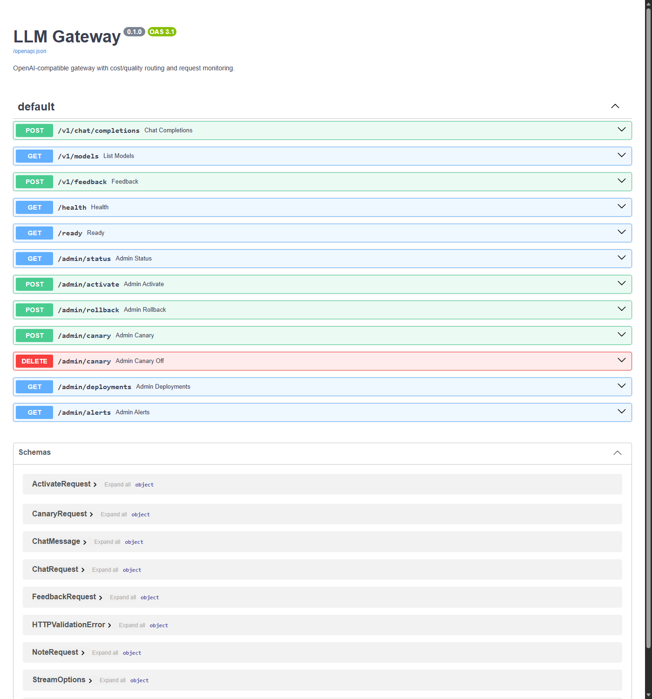
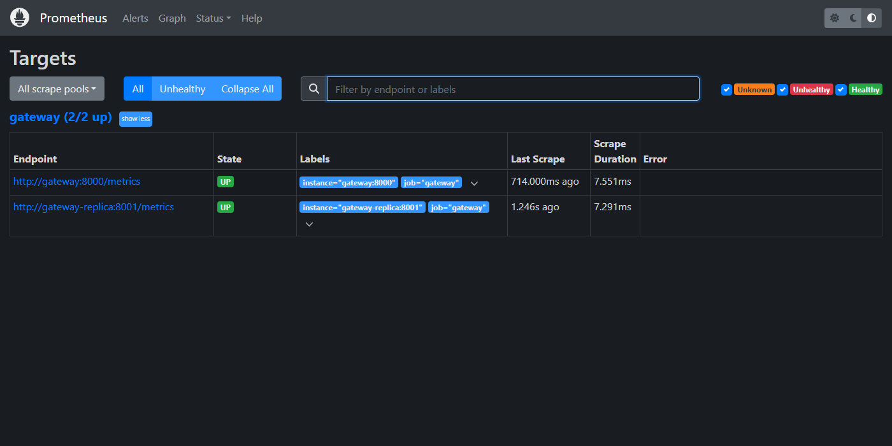
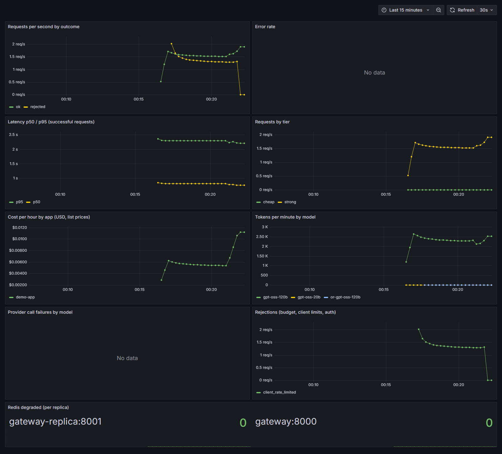
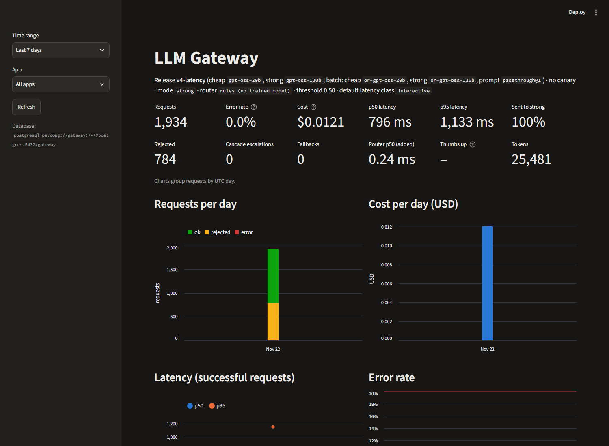
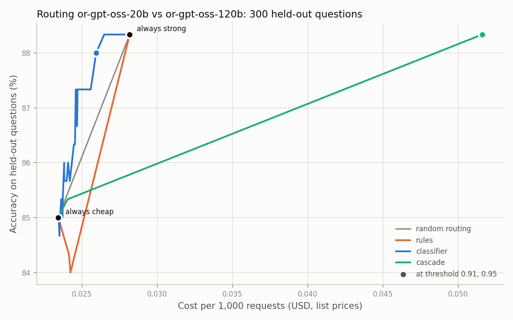

# Demo walkthrough

Everything on this page was captured on 2026-11-23 from the Docker Compose stack on a Windows laptop, with **fake
providers** (`GATEWAY_FAKE_PROVIDERS=1`): the answers are placeholder text such as `[openai/gpt-oss-20b] fake answer
to: ...`, and no provider was called. The routing, limits, logging, metrics and dashboards are the real gateway code.
Real-provider evidence is separate: [`results/real_provider_smoke.json`](../results/real_provider_smoke.json) (four
requests through the HTTP API) and the router evaluation in [ROUTING.md](ROUTING.md).

For the demo only, the gateway returned its routing metadata (`GATEWAY_EXPOSE_METADATA=1`; hidden by default) and
Grafana allowed read-only anonymous viewing so a headless browser could screenshot it. Neither is in the shipped
configuration.

## 1. Start the stack

```bash
python scripts/make_api_key.py demo-app            # or any GATEWAY_API_KEYS value for local use
GRAFANA_ADMIN_PASSWORD=<choose one> docker compose --profile monitoring up -d --build   # .env: GATEWAY_FAKE_PROVIDERS=1
docker compose ps
```

```
SERVICE           IMAGE                     STATUS                    PORTS
dashboard         llm-gateway:local         Up (healthy)              127.0.0.1:8501->8501/tcp
gateway           llm-gateway:local         Up (healthy)              127.0.0.1:8000->8000/tcp
gateway-replica   llm-gateway:local         Up (healthy)              127.0.0.1:8001->8001/tcp
grafana           grafana/grafana:11.3.0    Up                        127.0.0.1:3000->3000/tcp
postgres          postgres:16-alpine        Up (healthy)              127.0.0.1:54320->5432/tcp
prometheus        prom/prometheus:v2.55.1   Up                        127.0.0.1:9090->9090/tcp
redis             redis:7-alpine            Up (healthy)              127.0.0.1:63790->6379/tcp
```

Every port is bound to `127.0.0.1`; public traffic would go through the HTTPS proxy (`--profile proxy`).

`GET /health`:

```json
{
  "status": "ok", "version": "0.1.0", "release": "v4-latency", "canary": null, "default_mode": "strong",
  "classifier_threshold": 0.955, "router": "rule-based baseline (no trained classifier yet)",
  "fake_providers": true, "auth": "api_keys",
  "state": {"backend": "redis", "ready": true, "distributed": true, "degraded": false, "outage_policy": "fail_closed"}
}
```

## 2. API documentation (Swagger UI)

FastAPI serves interactive docs at `http://127.0.0.1:8000/docs`.



## 3. Routing modes (mock demonstration)

The same question with each `model` value. `gateway` is the routing metadata the demo exposed:

```bash
curl -s http://127.0.0.1:8000/v1/chat/completions \
  -H "Authorization: Bearer $KEY" -H "Content-Type: application/json" \
  -d '{"model": "router", "messages": [{"role": "user", "content": "What is 17 * 23?"}]}'
```

| `model` | Decided by | Score | Tier | Model that answered | Cost (list price) |
|---|---|---|---|---|---|
| `auto` | config default (`strong`) | – | strong | `gpt-oss-120b` (Groq) | $0.0000084 |
| `cheap` | request | – | cheap | `gpt-oss-20b` (Groq) | $0.0000042 |
| `strong` | request | – | strong | `gpt-oss-120b` (Groq) | $0.0000084 |
| `router` | rule-based router | 0.65 ≥ 0.5 | cheap | `gpt-oss-20b` (Groq) | $0.0000042 |
| `cascade` | cheap first, answer check passed | – | cheap | `gpt-oss-20b` (Groq), not escalated | $0.0000042 |
| `strong` + `X-Gateway-Latency: batch` | latency class | – | strong | `or-gpt-oss-120b` (OpenRouter) | $0.0000024 |

The last row is the provider choice: batch traffic goes to the cheaper, slower OpenRouter host of the same model.
Fallback between providers is exercised by the test suite (`tests/test_latency_routing.py`) and by the real-provider
smoke test (a Groq 401 falling back to OpenRouter), not by this mock stack.

## 4. Streaming (mock demonstration)

```bash
curl -sN http://127.0.0.1:8000/v1/chat/completions -H "Authorization: Bearer $KEY" -H "Content-Type: application/json" \
  -d '{"model": "cheap", "stream": true, "stream_options": {"include_usage": true},
       "messages": [{"role": "user", "content": "Name a primary colour."}]}'
```

```
data: {"id": "chatcmpl-7df8...", "object": "chat.completion.chunk", "model": "openai/gpt-oss-20b", "choices": [{"index": 0, "delta": {"role": "assistant", "content": "[openai/gpt-oss-20b]"}, "finish_reason": null}]}

data: {"id": "chatcmpl-7df8...", "object": "chat.completion.chunk", "model": "openai/gpt-oss-20b", "choices": [{"index": 0, "delta": {"content": " fake"}, "finish_reason": null}]}

...

data: {"id": "chatcmpl-7df8...", "object": "chat.completion.chunk", "choices": [], "usage": {...}, "gateway": {"mode": "cheap", "tier": "cheap", "model": "gpt-oss-20b", "latency_class": "interactive", "fallback": false, "cost_usd": 4.58e-06, ...}}

data: [DONE]
```

## 5. Authentication

```
HTTP/1.1 401 Unauthorized
content-type: application/json

{"error":{"message":"invalid or missing API key","type":"invalid_request_error","param":null,"code":"invalid_api_key"}}
```

## 6. Prometheus and Grafana

Both replicas scraped (`http://127.0.0.1:9090/targets`):



The provisioned Grafana dashboard after about two minutes of mixed traffic from `scripts/load_test.py` (10 clients,
20% streamed). The "rejected" series is the per-client limit (600 requests/minute) doing its job: the load test sent
more than that from one key, and those requests got HTTP 429 `client_rate_limited`. "No data" panels are error rate
and provider failures: there were none.



## 7. Request-log dashboard (Streamlit)

`http://127.0.0.1:8501/dashboard/` reads the PostgreSQL request log (behind a password when served through the
HTTPS proxy). The database password is masked.



## 8. Router evaluation

Offline, on 300 held-out benchmark questions answered by the real OpenRouter models
([`results/router_eval.md`](../results/router_eval.md)):



## Not demonstrated here, and how to see it

| Feature | How |
|---|---|
| Real provider answers | set provider keys in `.env`, unset `GATEWAY_FAKE_PROVIDERS`; or `python scripts/real_provider_smoke.py --dry-run`, then `--yes` (paid, capped at $0.01) |
| Fallback and circuit breakers live | `python scripts/multi_instance_check.py` (shared breaker and cooldown across two replicas); tests in `tests/test_circuit_breaker.py`, `tests/test_latency_routing.py` |
| Redis outage | `python scripts/redis_outage_drill.py --redis-url redis://127.0.0.1:56379/15 --container gateway-redis` |
| HTTPS proxy | `python scripts/make_proxy_secrets.py`, then `docker compose --profile proxy up -d`; `https://127.0.0.1/health` |
| Shadow mode report | `routing.shadow: true` with an installed classifier, then `python scripts/router_report.py` (kept off in the shipped config) |
