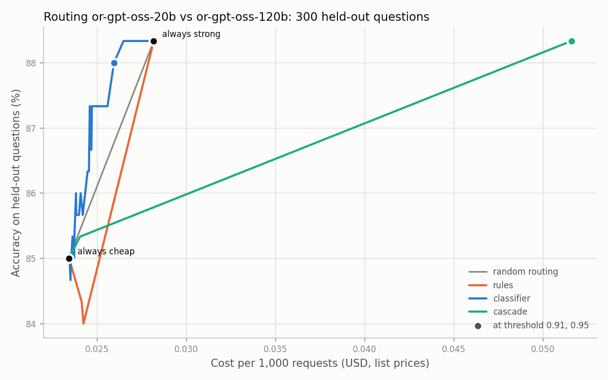

# Router evaluation

Held-out questions: 300 (gsm8k 100, mmlu 200). Cheap model `or-gpt-oss-20b`, strong model `or-gpt-oss-120b`. Training questions: 900. Costs use the list prices in the config.
Router: classifier (sentence-transformers/all-MiniLM-L6-v2, 900 training questions).

## Held-out results at thresholds chosen on the training split

Thresholds: rules 0.955 (chosen on the training answers); cascade 0.905 (chosen on the training answers); classifier 0.955 (chosen by train_router.py (out-of-fold)). Random routing sends the same share to the strong model as the classifier (67%).

| Strategy | Threshold | Accuracy | Cost per 1k requests | Sent to strong | Model time mean / p50 / p95 |
|---|---|---|---|---|---|
| always-cheap | - | 85.0% | $0.0234 | 0% | 2.03 / 1.55 / 5.22 s |
| always-strong | - | 88.3% | $0.0282 | 100% | 4.86 / 3.92 / 13.03 s |
| random | - | 87.2% | $0.0266 | 67% | 3.93 / - s |
| rules | 0.955 | 88.3% | $0.0282 | 100% | 4.86 / 3.92 / 13.03 s |
| classifier | 0.955 | 88.0% | $0.0259 | 67% | 3.73 / 2.72 / 9.78 s |
| cascade | 0.905 | 88.3% | $0.0516 | 100% | 6.90 / 5.81 / 15.55 s |

## Against always-strong (held-out, exact McNemar test)

| Strategy | Accuracy difference | Only it right | Only always-strong right | p | Cost saving |
|---|---|---|---|---|---|
| rules | +0.0 pts | 0 | 0 | 1.000 | 0% |
| classifier | -0.3 pts | 0 | 1 | 1.000 | 8% |
| cascade | +0.0 pts | 0 | 0 | 1.000 | -83% |

A strategy improves on always-strong only if it costs less at an accuracy difference the test can't tell from zero, or is more accurate with p < 0.05.

## Fixed-model baselines (held-out questions every model answered: 86)

| Model | Provider | Accuracy (95% CI) | Cost per 1k (est.) | Latency p50 / p95 ms |
|---|---|---|---|---|
| gpt-oss-120b | groq | 83.7% (75%-90%) | $0.0998 | 638 / 1,062 |
| gpt-oss-20b | groq | 77.9% (68%-85%) | $0.0485 | 547 / 846 |
| or-gpt-oss-120b | openrouter | 86.0% (77%-92%) | $0.0277 | 4,016 / 12,831 |
| or-gpt-oss-20b | openrouter | 82.6% (73%-89%) | $0.0230 | 1,450 / 2,646 |

The pair's strategies on the same 86 questions:

| Strategy | Threshold | Accuracy | Cost per 1k requests | Sent to strong | Model time mean / p50 / p95 |
|---|---|---|---|---|---|
| always-cheap | - | 82.6% | $0.0230 | 0% | 1.53 / 1.45 / 2.65 s |
| always-strong | - | 86.0% | $0.0277 | 100% | 4.99 / 4.02 / 12.83 s |
| rules | 0.955 | 86.0% | $0.0277 | 100% | 4.99 / 4.02 / 12.83 s |
| classifier | 0.955 | 86.0% | $0.0257 | 69% | 3.66 / 2.43 / 10.50 s |
| cascade | 0.905 | 86.0% | $0.0506 | 100% | 6.53 / 5.66 / 15.04 s |

## Descriptive: threshold sweep on the held-out set (cheapest within 1 percentage point(s) of always-strong, 88.3%)

Chosen by looking at the held-out answers, so this is a curve to read, not a result to claim.

| Router | Threshold | Accuracy | Cost per 1k requests | Saving vs always-strong |
|---|---|---|---|---|
| rules | 0.855 | 88.3% | $0.0282 | 0% |
| classifier | 0.935 | 87.3% | $0.0246 | 13% |
| cascade | 0.905 | 88.3% | $0.0516 | -83% |

## Added latency per request (this machine, CPU)

| Step | p50 | p95 |
|---|---|---|
| rules | 0.77 ms | 2.67 ms |
| classifier | 42.31 ms | 116.91 ms |
| cascade check | 0.05 ms | 0.11 ms |

## By source

| Source | Questions | Cheap right | Strong right | Cheap good enough |
|---|---|---|---|---|
| gsm8k | 100 | 94.0% | 95.0% | 99.0% |
| mmlu | 200 | 80.5% | 85.0% | 91.5% |

